# A GIS-Based Multi-Scenario Routing and Evacuation Planner

A static web app (no server, no database) for the real road network of **Tambaram, Chennai**. It loads
OpenStreetMap roads, places and buildings plus SRTM elevation, runs every algorithm in the browser, and draws
the results on a Leaflet map. All algorithms are written from scratch in JavaScript.

Mini project report: [`docs/Mini_Project_Report.pdf`](docs/Mini_Project_Report.pdf)

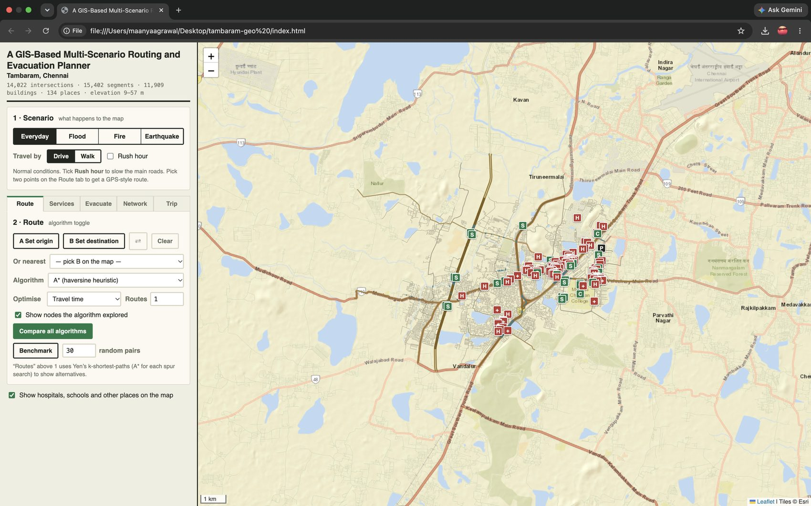

## Quick start

The real Tambaram data is already included in `data/dataset.js`, so there is nothing to install.

1. Download or clone this repository.
2. Open `index.html` in Chrome (double-click, no server needed).
3. Optional: open `index.html?tiles=none` if the background map tiles do not load (roads still draw), or `index.html?tiles=osm` for OpenStreetMap tiles.

To download fresh data (needs internet and Node.js):

```
node tools/fetch-osm.js                      # default area: Tambaram, Chennai
node tools/fetch-osm.js --bbox 12.90,80.06,12.95,80.13 --name "Tambaram, Chennai"   # custom box (south,west,north,east)
node tools/test.js                           # 38 algorithm tests
node tools/test-fetch.js                     # data-parsing tests
```

## Features

| Tab / control | Feature | Algorithm |
|---|---|---|
| Scenario: Everyday | GPS-style routing, rush hour | Dijkstra, A*, bidirectional Dijkstra, Bellman-Ford (selectable), Yen's k-shortest paths |
| Scenario: Flood | water level on SRTM elevation, connected flooding, wading on foot | BFS over the road graph |
| Scenario: Fire | spread with wind, routes must beat the fire to every node | multi-source Dijkstra + time-dependent (deadline) search |
| Scenario: Earthquake | damage probability by distance, fragile bridges, reliability | Monte Carlo + union-find |
| Route | compare and benchmark all algorithms | Dijkstra, A*, bidirectional, Bellman-Ford |
| Services | catchment area and percentage of population covered | multi-source reverse Dijkstra |
| Evacuate | assign zones to shelters under capacity, road load, new shelter sites | min-cost max-flow (SSP + SPFA), k-means++, greedy max-coverage |
| Network | single points of failure, most critical roads | Tarjan bridges / articulation points, Brandes betweenness |
| Trip | multi-stop round trip | nearest neighbour, 2-opt, Held-Karp (exact) |

Design rule: a scenario only changes the graph (blocked segments, slowed segments, node deadlines). Every algorithm
then runs unchanged on the modified graph.

## Screenshots

| | |
|---|---|
| 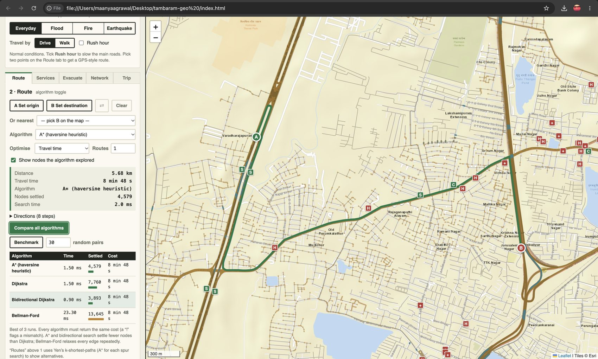 Route with A* and algorithm comparison | 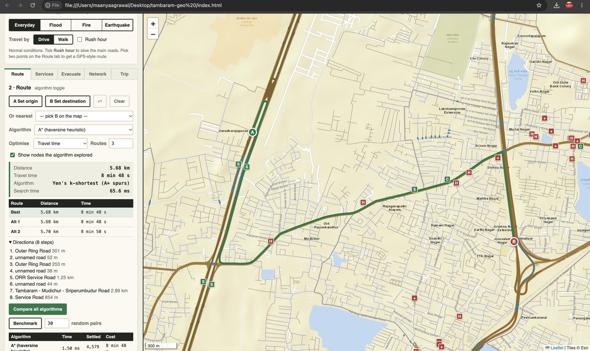 Alternative routes (Yen) |
| 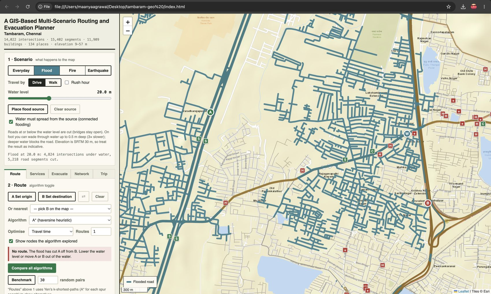 Flood | 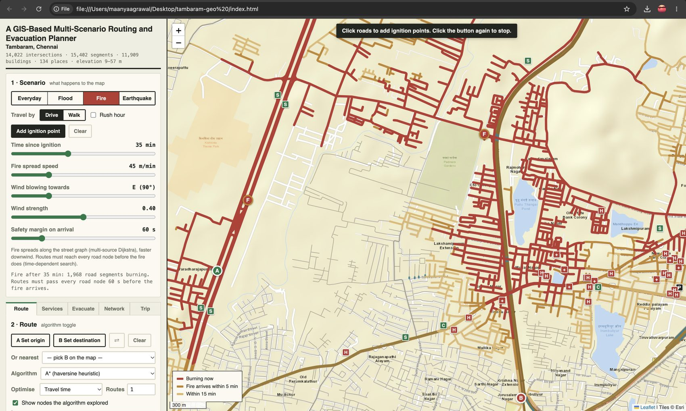 Fire |
| 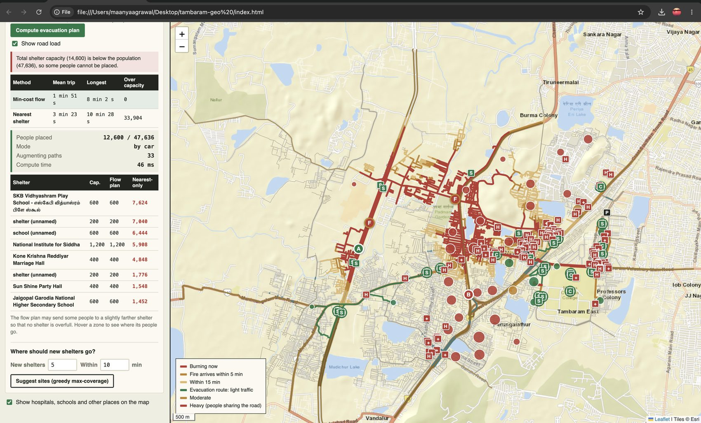 Evacuation plan | 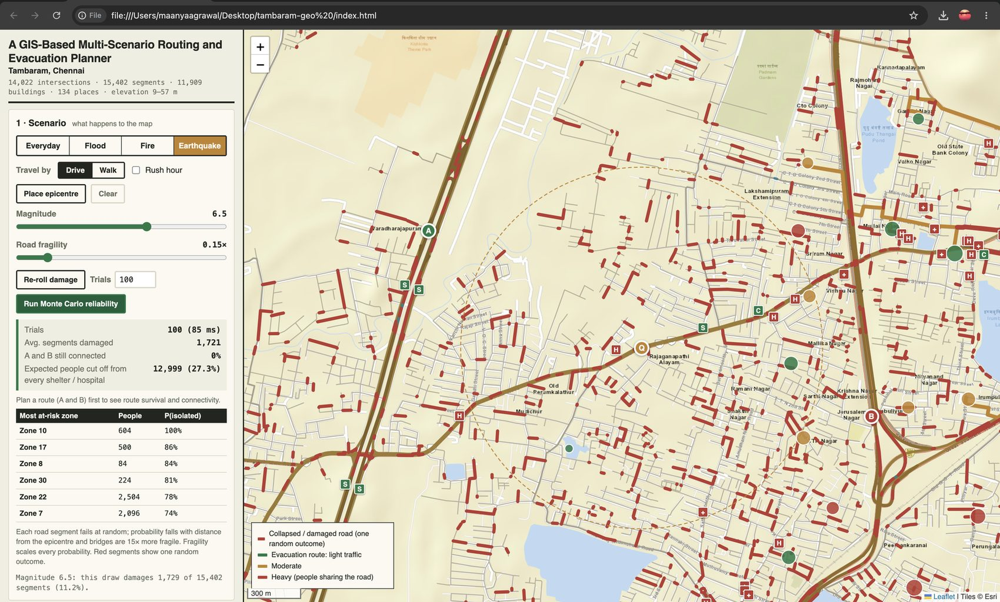 Earthquake and Monte Carlo |
| 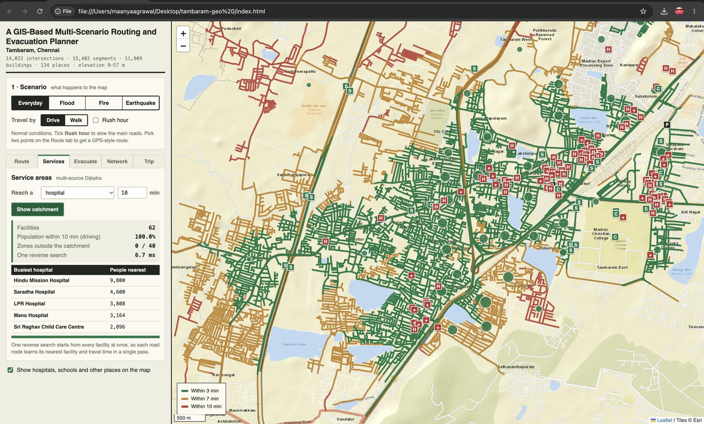 Service area | 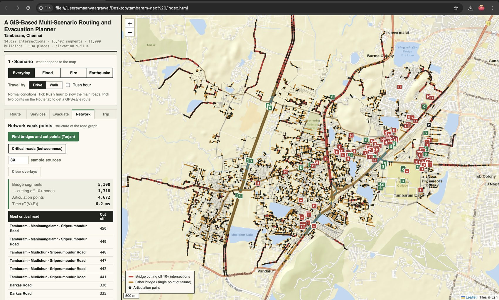 Network weak points |
| 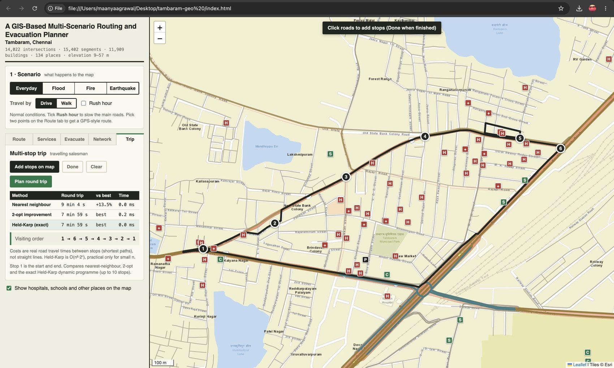 Multi-stop trip | 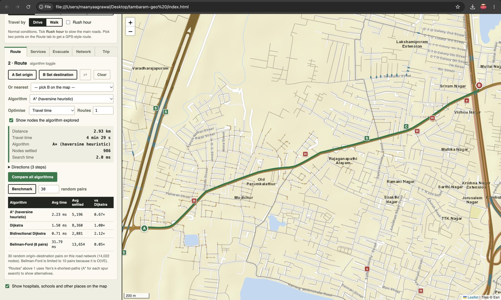 Benchmark |

All screenshots are in the `screenshots/` folder.

## Complexity (V = intersections, E = road segments)

| Algorithm | Time | Notes |
|---|---|---|
| Dijkstra (binary heap) | O((V+E) log V) | optimal, non-negative weights |
| A* | same worst case, far fewer nodes in practice | heuristic = haversine distance x cheapest cost per metre (admissible and consistent) |
| Bidirectional Dijkstra | about half the nodes of Dijkstra | stops when the two frontiers meet |
| Bellman-Ford | O(VE) | round-based with early exit; benchmark baseline |
| Yen's K shortest | O(K V (V+E) log V) | A* for each spur path |
| Multi-source Dijkstra | O((V+E) log V) | one pass for all facilities |
| Tarjan bridges | O(V+E) | iterative low-link DFS |
| Brandes betweenness | O(k (V+E) log V) | k sampled sources (approximation) |
| Min-cost max-flow | O(F x SPFA) | successive shortest paths |
| Greedy max-coverage | O(k C Z) | at least (1 - 1/e) of optimal |
| Held-Karp | O(n^2 2^n) | exact TSP, n up to 12 |

## Assumptions and limitations

- Road speeds by class, rush-hour multipliers and walking speed (1.35 m/s) are assumed values (top of `js/graph.js`).
- Population is not census data: OSM building centroids are grouped with k-means and multiplied by "people per building".
- Shelter capacities are inputs on the Evacuate tab, not real figures.
- Elevation is SRTM 30 m, sampled on a coarse grid and interpolated. Flooding is a level-set model (no rainfall or drainage), so it is indicative.
- Fire spread, wind effect and earthquake damage are simple, explainable models, not engineering predictions.
- Only the largest connected part of the road network is used.

## Project structure

```
index.html  css/style.css  js/app.js          user interface
js/core.js graph.js algos.js scenarios.js      algorithms and models (pure JS, also run under Node)
data/dataset.js                                real Tambaram data (window.GEO_DATASET)
tools/fetch-osm.js                             downloads real data -> data/dataset.js
tools/make-synthetic.js                        generates a synthetic test city
tools/test.js  tools/test-fetch.js             tests
lib/                                           Leaflet 1.9.4 (vendored, works offline)
screenshots/  docs/                            screenshots and the project report
```

## Data and credits

- Road network, places and buildings: (c) OpenStreetMap contributors, available under the Open Database Licence (https://www.openstreetmap.org/copyright), downloaded through the Overpass API.
- Elevation: SRTM 30 m via the OpenTopoData API.
- Map display: Leaflet 1.9.4. Background tiles: Esri (default) or OpenStreetMap.

Author: Maanya Agrawal (24BCE5052), B.Tech CSE, VIT Chennai.
